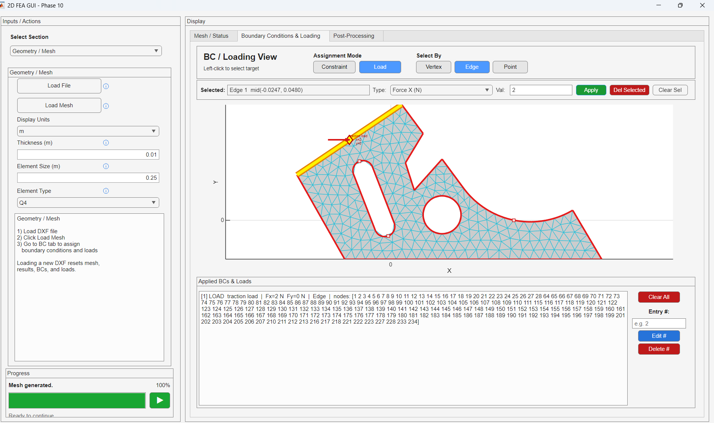
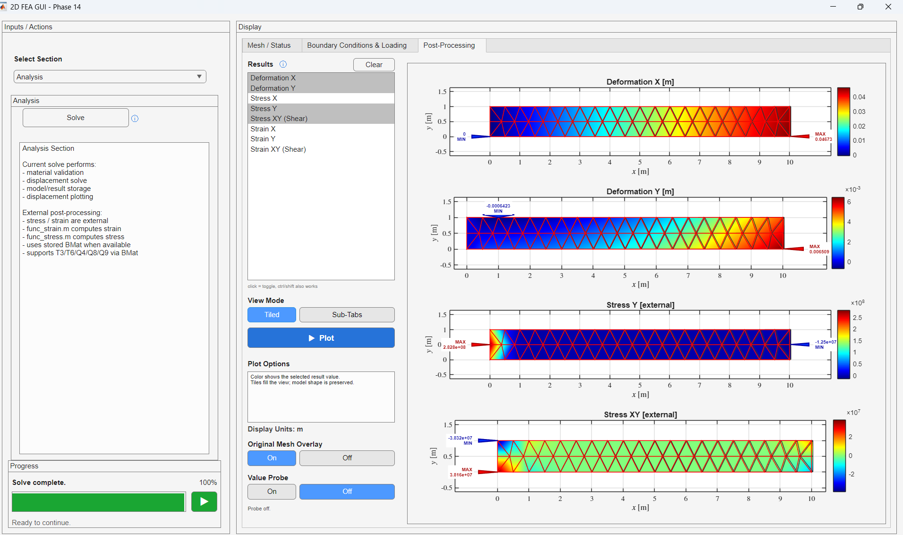
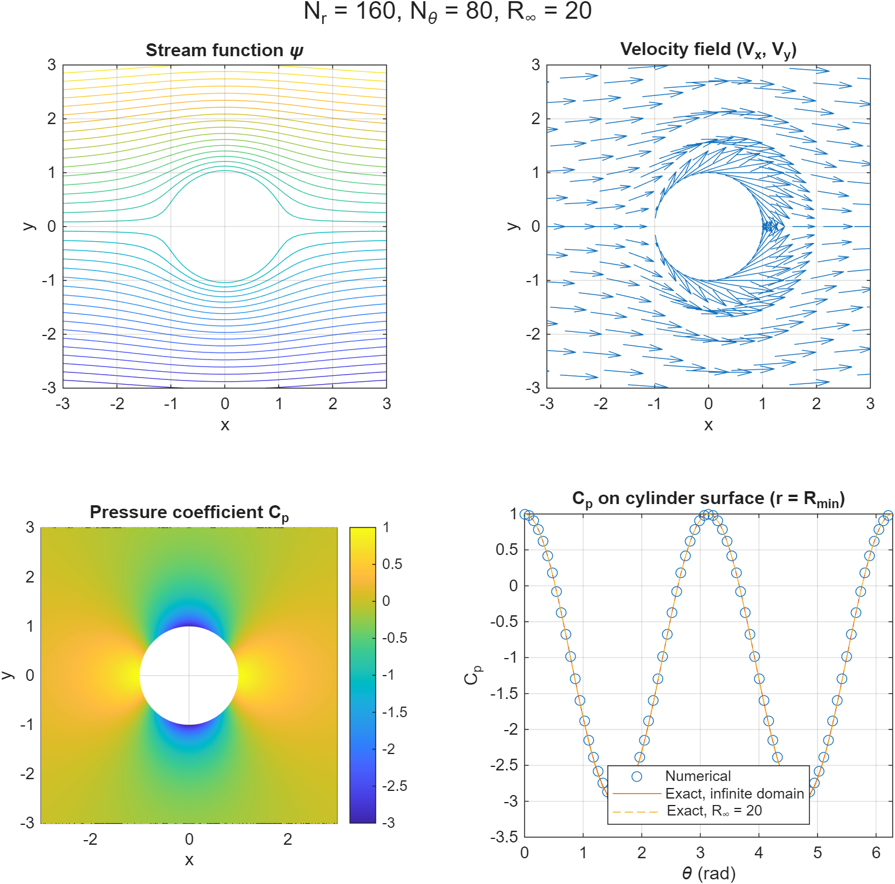
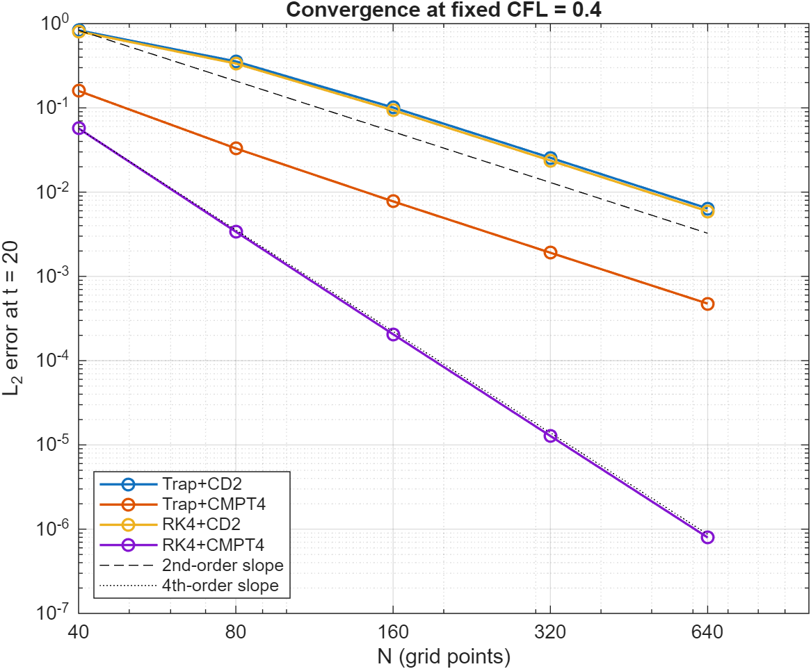

# ME-Portfolio
This portfolio showcases my engineering projects, simulations, and applications of MATLAB, ANSYS, and numerical methods .

# Custom 2D Finite Element Analysis Program 
[Matlab FEA Project](https://github.com/phaylent/ME522_MatlabFEAProject.git)

A MATLAB-based 2D structural finite element analysis (FEA) application developed by a team of three over five weeks. The program supports geometry creation, mesh generation, boundary condition assignment, and stress and deformation visualization, with an auto-convergence solver for mesh refinement.

My primary contributions focused on boundary condition assignment, post-processing, and solver convergence.

- **Boundary Conditions:** Implemented functionality for assigning boundary conditions and applying loads to the model.
- **Post-Processing:** Developed visualization tools for displaying structural deformation and stress results along with calculations.
- **Auto-Convergence Solver:** Implemented an iterative mesh refinement process that continues until the specified error tolerance is met.

  
  

  <em>Left: boundary condition and load assignment. Right: post-processing of deformation and stress.</em>

## Finite-Difference CFD Solvers in MATLAB

[numerical-fluids-matlab](https://github.com/phaylent/numerical-fluids-matlab)

A set of MATLAB solvers I developed individually to study numerical methods for fluid flow, covering incompressible potential flow, advection schemes, and compressible duct flow. Each solver is validated against an exact or analytical solution, with grid-convergence studies.

- **Potential Flow Over a Cylinder:** Solved the 2D Laplace equation for the stream function on a stretched polar mesh using sparse finite differences, demonstrating second-order convergence (max ψ error 9.9×10⁻³ → 1.6×10⁻⁴ over four mesh levels). Separated discretization error from domain-truncation error by deriving the finite-domain exact solution, and verified that full-cylinder pressure forces vanish to roundoff (d'Alembert's paradox).
- **Advection Schemes:** Implemented Trapezoidal and RK4 time integration with second-order central and fourth-order compact spatial schemes for 1D linear advection. Verified observed convergence orders of 2 for three pairings and 4 for RK4 + compact, and used Fourier analysis to show the errors are dispersion-dominated.
- **Compressible Duct Flow:** Built a Newton solver (finite-difference Jacobian) for adiabatic flow with wall friction, solving the forward problem (prescribed inlet Mach number) and the inverse problem (prescribed exit pressure). Validated against the analytic Fanno-flow solution (max error ~3×10⁻⁶ at 200 grid points), showed second-order grid convergence, and computed the choking limit (M₁ ≈ 0.509 for fL/D = 1).

  
  
  

*Left: stream function, velocity, and surface pressure coefficient for flow over a cylinder. Center: convergence of the four time/space scheme pairings (second- and fourth-order). Right: numerical duct-flow profiles against the analytic Fanno solution.*

## Steady-State Thermal Analysis of a Heated Sphere

A thermal finite element analysis project using ANSYS Mechanical and MATLAB to investigate steady-state heat conduction in a solid sphere with internal volumetric heat generation and surface heat transfer. The project combines a 3D thermal model using one-eighth symmetry, an analytical solution, and a 1D finite element solver to compare temperature distributions and verify numerical results.

Focused on thermal modeling, analytical solutions, and numerical validation:

- **ANSYS Thermal FEA:** Created a one-eighth solid model of the sphere, applied thermal boundary conditions and internal heat generation, and extracted the temperature distribution from the center to the outer surface.
- **Analytical Solution:** Derived and implemented the spherical heat conduction solution in MATLAB to calculate the radial temperature profile.
- **1D Finite Element Solver:** Implemented a five-element heat conduction model in MATLAB, assembling the global stiffness matrix and forcing vector to solve for nodal temperatures.
- **Numerical Validation:** Compared the analytical solution, ANSYS results, and 1D FEA solution. The ANSYS model produced a center temperature of 407.67 K and a surface temperature of 392.06 K, corresponding to a radial temperature difference of 15.61 K.

[Temperature distribution comparison](https://github.com/phaylent/ME-Portfolio/blob/main/images/temperature_comparison.png) ([image](https://github.com/phaylent/ME-Portfolio/raw/main/images/temperature_comparison.png)) [ANSYS temperature contour](https://github.com/phaylent/ME-Portfolio/blob/main/images/temperature_contour.png) ([image](https://github.com/phaylent/ME-Portfolio/raw/main/images/temperature_contour.png))

*Left: analytical temperature profile compared with the ANSYS and 1D FEA solutions. Right: temperature distribution in the one-eighth sphere model.*

The thermal modeling and validation methods are relevant to aerospace thermal analysis, including the evaluation of temperature gradients and heat transfer in structural components. The model is a simplified heated-sphere problem and does not directly simulate aerodynamic heating or transient atmospheric re-entry.

The model represents a simplified heated sphere rather than a complete atmospheric re-entry simulation; it does not directly model aerodynamic heating or transient re-entry conditions.
